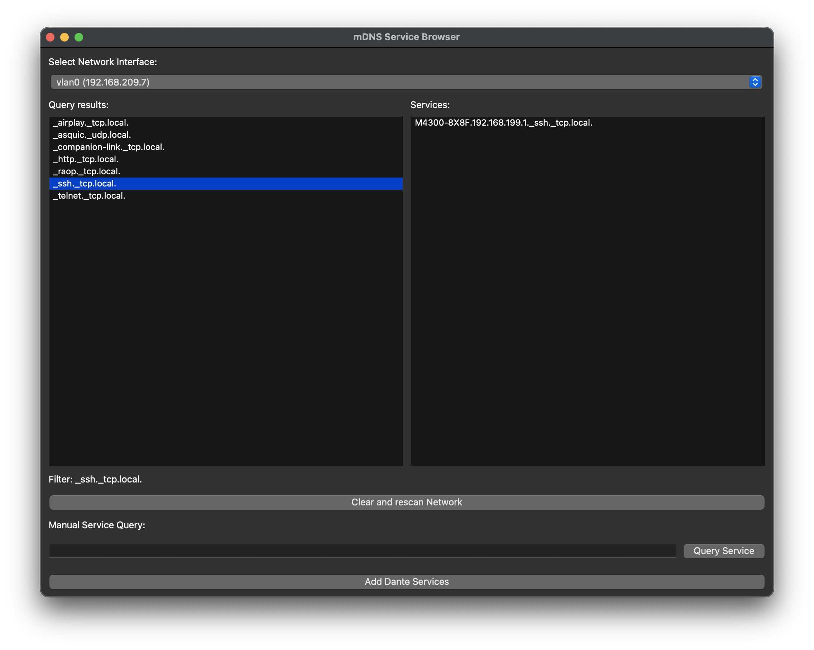
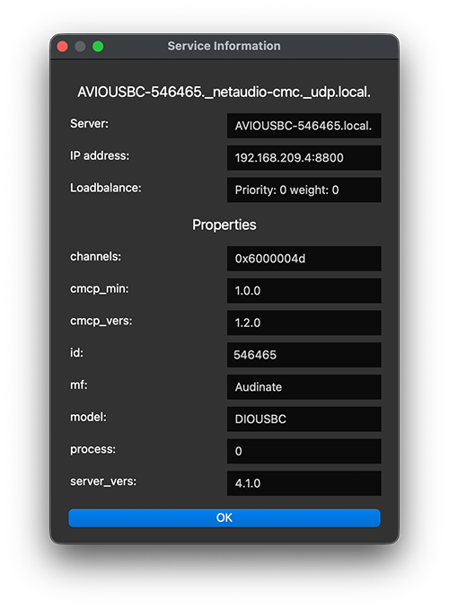

# mDNS and UPnP Service Browser (Async, PyQt6)

A cross-platform **mDNS / DNS-SD and UPnP / SSDP service discovery tool** built with **PyQt6**, Python’s **asyncio Zeroconf API**, and `async-upnp-client`.
It allows you to browse, filter, and inspect network services and UPnP devices (including **Dante audio devices**) in real time.




---

## ✨ Features

- 🔍 **Automatic discovery** of all mDNS service types (`_services._dns-sd._udp.local.`)  
- 📡 **UPnP / SSDP discovery** for devices such as media renderers, routers, and smart devices
- 🏷️ **Readable UPnP device list** with friendly names, manufacturer/model, device type and address; repeated advertisements are combined per device
- 🔎 **UPnP search** by name, model, manufacturer or address, with readable type filters and an **All devices** view
- 🎚️ **Filter and browse** mDNS services and UPnP devices in separate tabs
- 📜 **Detailed service info** including addresses, TXT properties, SSDP headers, priority, weight
- 🌐 **Interface selection** – scan on a specific interface or all interfaces  
- 🔄 **Rescan & refresh** with one click  
- 📝 **Manual service query** with auto-correction for `.local.` suffix  
- 🎵 **Quick Dante queries** for `_netaudio._udp.local.` etc.  
- ✅ Cross-platform (Linux, macOS, Windows)

---

## 🚀 Installation

### Requirements
- Python **3.9+**
- [python-zeroconf](https://github.com/jstasiak/python-zeroconf) (newer versions with `AsyncZeroconf`)
- [async-upnp-client](https://github.com/StevenLooman/async_upnp_client)
- [PyQt6](https://pypi.org/project/PyQt6/)
- [psutil](https://pypi.org/project/psutil/)

### Install dependencies
```bash
pip install -r requirements
```

---

## ▶️ Usage

Run the app:

```bash
python src/app.py
```

or build an executable with the spec files 

### Build the macOS app

With dependencies and PyInstaller installed in the project's `.venv`, run:

```bash
bash spec/build_macos.sh
```

The app is written to `dist/mDNSBrowser.app`. The script also works from inside
`spec` (`bash build_macos.sh`). It includes `src` in PyInstaller's import search
path so local modules such as `upnp` and `os_qt_tools` are bundled.

To see a startup error in Terminal, launch the executable directly:

```bash
./dist/mDNSBrowser.app/Contents/MacOS/mDNSBrowser
```

### Basic workflow
1. Select an interface (`All interfaces` or a specific adapter/IP).
2. Use the **mDNS** and **UPnP** tabs to switch between discovery methods.
3. Select a type to filter and view discovered **services or devices** on the right panel.
4. Click a service to open a detailed info dialog with TXT records or SSDP headers.
5. In the **mDNS** tab, use **Manual mDNS Service Query** to search for a service type (input auto-corrects `.local.`).
6. In the **mDNS** tab, use **Add Dante mDNS Services** to query common Dante services.

**All interfaces** searches for UPnP devices on every active IPv4 multicast interface
at the same time, including Wi-Fi and Ethernet. A failed search on one adapter does not
prevent discovery on the others. Selecting a specific adapter limits discovery to that network.

UPnP names are loaded automatically from each device's description. Devices that do not
provide a readable description still appear using their address. The details dialog keeps
the device ID and the original SSDP headers for every advertisement.

### macOS: no devices or “No route to host”

If both discovery tabs stay empty and multicast sends report `[Errno 65] No route to host`,
check **System Settings → Privacy & Security → Local Network**. Enable access for the
app that launches the browser: for example, **PyCharm** when running from that IDE, or
**mDNSBrowser** when running the packaged app. Fully quit and reopen that app, then rescan.

To compare discovery outside the IDE, run the same source from Terminal:

```bash
cd /path/to/mDNSBrowser
.venv/bin/python src/app.py
```

macOS applies local-network access to the responsible launching app; a successful run
from Terminal does not establish that an IDE has permission. See
[Apple's local network privacy documentation](https://developer.apple.com/documentation/technotes/tn3179-understanding-local-network-privacy).

---

## 🛠️ Development Notes

- Uses `AsyncZeroconf` for async mDNS service browsing.
- Uses `async-upnp-client` to run recurring `ssdp:all` searches for UPnP devices.
- Runs an `asyncio` event loop in a background thread.  
- Communicates with the PyQt6 main thread via Qt signals for **thread-safe UI updates**.  
- Service resolution uses `async_get_service_info()` with a timeout of **3s**, retriable if needed.  
- Input normalization ensures user queries work even if `.local.` is missing.  
- UPnP description requests run in the background with a four-second timeout and shared caching, including metadata for embedded devices.

Run the discovery and UI regression tests without accessing the network:

```bash
QT_QPA_PLATFORM=offscreen .venv/bin/python -m unittest discover -s test -p 'test_*.py'
```

---

## 📦 Project Structure
```
src/
  app.py         # Main PyQt6 app and AsyncZCWorker
README.md
```

---

## 🔮 Roadmap
- [ ] Add **collapsible properties section** in service info dialog  
- [ ] Retry resolution for slow-responding devices  
- [ ] Configurable list of **favorite service types** (like Dante)  
- [ ] Dark/light theme toggle  

---

## 📜 License
MIT © 2025 Thorsten Wagener 
